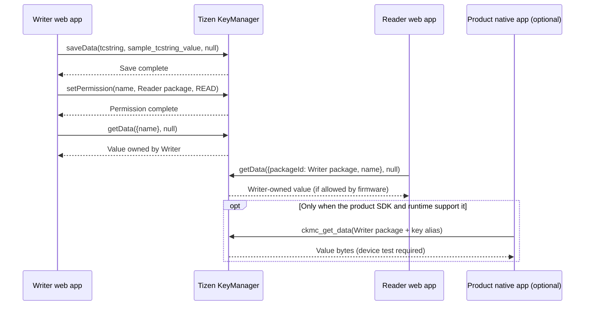

# Tizen KeyManager implementation guide

**English** | [한국어](ko/GUIDE.md) | [Project README](../README.md)

This guide targets Samsung TVs from 2017 onward running Tizen 3.0 or later. It explains how a web app can set a string and how a separate web package or an existing product native app can get it, subject to support on the target firmware. The starting sample value is public test data: key `tcstring`, value `sample_tcstring_value`.

The app button labels remain Korean. When a step refers to a button, its displayed label appears in quotation marks so you can find it in the app.

## Data flow



The web app that calls `saveData` owns the item. Writer grants `READ` to the Reader's **package ID** with `setPermission`. Reader specifies Writer's package ID when it calls `getData`. Do not confuse an application ID with a package ID. Native code also queries the Writer as the owner. Verify this behavior on the target TV.

## Package IDs

| App | Web package ID | Application ID |
| --- | --- | --- |
| Writer | `KmWriter01` | `KmWriter01.Writer` |
| Reader | `KmReader01` | `KmReader01.Reader` |

The single source for these values is `samples.config.json`. The build creates each app's `config.xml` and browser-side `js/sample-config.js`. The Tizen WRT specification uses a 10-character alphanumeric package ID and an application ID of the form `<package>.<app-name>`. If you replace either ID, update the corresponding application ID prefix and any product native configuration too. [Tizen 3.0 WRT specification](https://docs.tizen.org/platform/compliance/media/tizen-3.0-wrt-core-spec.pdf)

The manifests set `required_version="3.0"` and the `tv-samsung` profile. They do not declare the KeyManager privilege: the Samsung reference says it is not required for the Web API on Tizen 3.0 and later. Check any newer SDK requirements, and do not add arbitrary privileges or broad origins. [Samsung KeyManager API](https://developer.samsung.com/smarttv/develop/api-references/tizen-web-device-api-references/keymanager-api.html)

## Writer set and access control

The Writer save action creates a new item only:

1. Writer checks whether its own `tcstring` item already exists. It stops if the item exists. It calls save only when `getData` raises `NotFoundError`.
2. It calls `tizen.keymanager.saveData("tcstring", "sample_tcstring_value", null, success, error)`. Do not assume this operation overwrites an existing item or acts as an upsert.
3. After the save callback, Writer calls `setPermission({name: "tcstring"}, readerPackageId, "READ", success, error)`.
4. Once both operations succeed, select **“Writer에서 읽기(get)”** to check the same app's get result. Saving does not trigger an automatic read or start the native app.

If the API is missing or the initial read fails with an error other than `NotFoundError`, Writer stops and reports the error. It does not convert an error into a successful read, an empty string, or a local-storage fallback.

### Partial success and recovery

When saving succeeds but granting `READ` fails, the item already exists. The UI reports that save and permission setup have different outcomes. Use **“READ 다시 부여”** to retry the ACL step without writing the item again. If the optional product native package ID is configured, the Writer separately reports its `READ` result. A failed target must not be shown as successful. If permission revocation fails, select **“공유 해제”** again; do not advise restoring `READ` as recovery from a failed revocation.

Revocation calls `setPermission({name}, readerPackageId, "NONE", ...)` for this test item. The sample does not request `READ_REMOVE` or change any other app's data. Deletion is a separate, explicitly confirmed action and never runs at startup, reconnect, or build time. To test a new save after deleting, start a new item creation from Writer.

### Button sequence

In the Writer web app, select **“tcstring 저장(set) + READ”**, then **“Writer에서 읽기(get)”**. Open the Reader web app and select **“tcstring 읽기(get)”**. The Reader never sets the value or changes permissions. To reset the sample, select **“삭제 단계 열기”** and then **“tcstring 삭제”** in Writer.

## Reader get

Reader does not save its own item. It synchronously gets the Writer-owned value by naming the owner package ID:

```js
var value = tizen.keymanager.getData({
  packageId: writerPackageId,
  name: "tcstring"
}, null);
```

Opening Reader does not save data or change permissions. If the item is missing or access is denied, the app reports the error. Results can vary with the TV firmware and its security policy, so test each target combination.

## Native C++ get example

`native/` contains a get example for integration into an existing product app with a supported native runtime. Samsung documents Web WGTs as the public TV app path and says Native TPK installation is not supported in its regular TV application-testing flow. This code is not a standalone TV app and does not establish that a public Samsung TV Native SDK can build it. [Samsung TV FAQ](https://developer.samsung.com/smarttv/develop/faq/application-testing.html)

The example creates an owner-qualified alias with `ckmc_alias_new(writerPackageId, key, &alias)` and reads it with `ckmc_get_data(alias, nullptr, &buffer)`. Supply Writer's package ID, the key, and the expected public sample value to `km_run_keymanager_demo(writerPackageId, key, expectedValue)` from the existing product configuration. Free the alias with `free()` and the returned buffer with `ckmc_buffer_free()`. Copy the buffer's `size` bytes; do not assume NUL termination. The example prints a comparison result rather than the stored string. See the [native integration guide](../native/README.md) and the Tizen [Key Manager types](https://docs.stg.tizen.org/application/native/api/mobile/4.0/group__CAPI__KEY__MANAGER__TYPES__MODULE.html) and [client API](https://docs.stg.tizen.org/application/native/api/common/9.0/group__CAPI__KEY__MANAGER__CLIENT__MODULE.html) references.

The optional `nativePackageId` defaults to empty, so Writer skips the native permission step until you configure it. Enter the actual product **package ID**, rebuild, then use Writer to grant `READ` and check the permission result. Building packages does not change KeyManager permissions. Do not substitute a daemon name or UID for the package ID. For a system daemon, first confirm its security identity and access policy in the product image.

## Handling values

The sample value is public test data. Never put a real secret into the source or the WGT. A value returned by KeyManager is still plaintext in app memory. Do not copy it to the UI, console, files, or crash logs. `null` and `nullptr` mean the sample does not set an additional per-item password; they do not turn off platform storage protection. This sample does not establish TEE use, specific hardware protection, or identical protection across TV firmware.

## Check KeyManager availability on the target

Samsung's [KeyManager API reference](https://developer.samsung.com/smarttv/develop/api-references/tizen-web-device-api-references/keymanager-api.html) documents the TV API. The [Seller Office launch checklist](https://developer.samsung.com/tv-seller-office/checklists-for-distribution/launch-checklist.html#privilege-api) also says that KeyManager is no longer provided in its privilege guidance. The documents differ in context; do not infer universal support or removal. Record the TV model year, firmware, and distribution path, then test API presence, `saveData`, ACL changes, and the separate Reader get.

## Physical-device test plan

For each test, record the TV model year and model, firmware, Web SDK version, signing profile, result, and any error name or CKMC result code. Never record the actual value.

| ID | Test | Record |
| --- | --- | --- |
| T01 | Install both WGT apps with their separate package IDs | Confirm each app installs |
| T02 | Check whether the KeyManager API is present | Record the target and whether the API exists |
| T03 | Save a new item in Writer | Confirm the save callback runs once and the UI reports the result |
| T04 | Get from Writer | Check that the value matches `sample_tcstring_value` |
| T05 | Grant Reader `READ`, then get from Reader | Record whether access is allowed and any error |
| T06 | Set Reader permission to `NONE`, then get again | Confirm no value is returned; record the deny/error result |
| T07 | Regrant only the ACL | Confirm Reader access without saving again |
| T08 | Try to create the same key again | Confirm Writer does not overwrite the existing item |
| T09 | Try a missing key and an empty value | Distinguish an error from a successful empty string |
| T10 | Close/reopen the app and restart the TV | Check the stored value and ACL without an automatic write |
| T11 | Test any Unicode values needed by the product | Record Web/native encoding and byte behavior |
| T12 | Integrate with the product native runtime | Record the SDK build and get result with the same owner and ACL |
| T13 | Inspect logs for private data | Confirm the stored value is not logged |

An absent API or a denied cross-app read is a valid test result. Unit fixtures and ZIP checks do not replace physical-TV testing.
