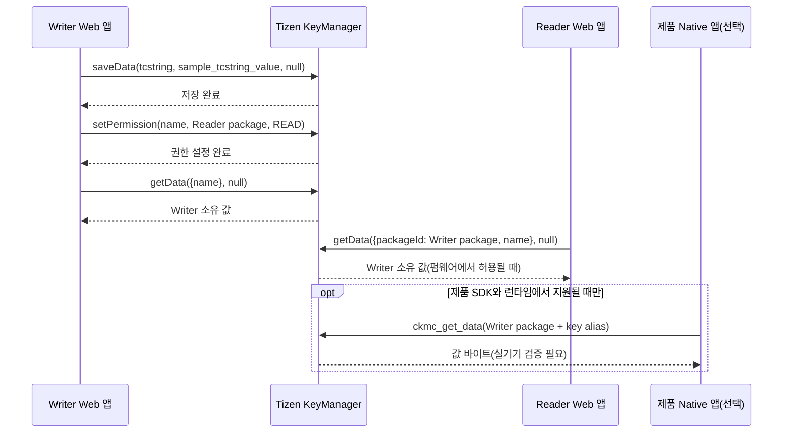

# Tizen KeyManager 실습 안내

[English](../GUIDE.md) | **한국어** | [프로젝트 README](../../README.ko.md)

이 안내는 Tizen 3.0 이상을 실행하는 2017년 이후 Samsung TV를 기준으로 Web 문자열 하나를 저장하고, 서로 다른 Web package와 제품용 Native 코드에서 읽는 흐름을 설명합니다. 첫 검증값은 비밀이 아닌 `tcstring` / `sample_tcstring_value`입니다.

## 처리 흐름



`saveData`의 소유자는 호출한 Web 앱입니다. Reader는 읽기 전에 Writer package ID가 지정된 조회를 수행하고, Writer는 `setPermission`으로 Reader **package ID**에 `READ`를 부여합니다. Application ID와 package ID를 혼동하지 마세요. Native 조회의 owner도 Writer ID입니다. 실제 UI·API 실행 여부는 TV 환경에서 확인해야 합니다.

## package ID

| 앱 | Web package ID | Application ID |
| --- | --- | --- |
| Writer | `KmWriter01` | `KmWriter01.Writer` |
| Reader | `KmReader01` | `KmReader01.Reader` |

이 값은 `samples.config.json` 한 곳에서 관리하며 WGT 빌드 시 앱별 `config.xml`과 브라우저용 `js/sample-config.js`를 생성합니다. WRT 명세의 package 형식은 10개의 영숫자이며 앱 ID는 `<package>.<app-name>` 형식이어야 합니다. 실제 제품 ID로 변경한다면 양쪽 앱 ID 접두사와 Native 설정도 함께 맞추세요. [Tizen 3.0 WRT 명세](https://docs.tizen.org/platform/compliance/media/tizen-3.0-wrt-core-spec.pdf)

앱 manifest는 `required_version="3.0"`, `tv-samsung` 프로필을 사용합니다. KeyManager privilege 선언은 추가하지 않습니다. 공식 API 문서는 Tizen 3.0 이상의 Web API에 해당 privilege 선언이 필요하지 않다고 안내합니다. 대상 SDK가 새 설정을 요구하는지 검토하되 TV 설치 프로필에서 임의의 privilege나 origin 허용을 추가하지 마세요. [Samsung KeyManager API](https://developer.samsung.com/smarttv/develop/api-references/tizen-web-device-api-references/keymanager-api.html)

## 저장과 ACL

Writer의 저장 흐름은 신규 항목에 대해서만 동작합니다.

1. Writer가 동일 소유자의 `tcstring` 존재 여부를 읽습니다. 이미 있으면 저장을 중단합니다. `getData` 오류가 `NotFoundError`인 경우에만 새 항목 저장을 진행합니다.
2. `tizen.keymanager.saveData("tcstring", "sample_tcstring_value", null, success, error)`를 호출합니다. 같은 key에 대한 자동 덮어쓰기나 upsert를 지원한다고 가정하지 않습니다.
3. 저장 콜백 뒤 `setPermission({name: "tcstring"}, readerPackageId, "READ", success, error)`를 호출합니다.
4. 두 단계가 성공하면 **Writer에서 읽기** 버튼으로 같은 앱의 get 결과를 확인합니다. 저장 직후 자동 읽기나 Native 실행을 가정하지 않습니다.

API가 없거나 초기 읽기가 `NotFoundError`가 아닌 경우 저장 단계로 넘어가지 않습니다. 오류를 성공·빈 문자열로 바꾸지 마세요.

### 부분 성공과 복구

저장 성공 뒤 권한 부여가 실패하면 값은 이미 저장되어 있습니다. 화면은 저장 완료와 권한 설정 실패를 구분해 보여 주며, 새 저장을 반복하지 않고 ACL만 재시도합니다. 제품 Native package ID를 선택해 빌드했다면 해당 ID의 `READ` 부여 단계도 별개로 결과를 표시합니다. 실패한 대상의 권한을 성공한 것처럼 표시하지 않습니다. 권한 해제에 실패했다면 **공유 해제**를 다시 실행합니다.

권한 해제는 시험용 `tcstring`에 대해 `setPermission({name}, readerPackageId, "NONE", ...)`로 수행합니다. 임의로 `READ_REMOVE` 권한을 요청하거나 다른 앱의 데이터를 수정하지 마세요. 키 삭제는 별도 확인 동작이며 시작·재접속·빌드에 결합하지 않습니다. 삭제 후 저장을 다시 수행하려면 Writer에서 새 항목 생성을 명시적으로 시작합니다.

## Reader 앱

Reader는 자체 키를 저장하지 않습니다. 다음과 같이 소유 package ID를 명시해 값을 동기 읽기합니다.

```js
var value = tizen.keymanager.getData({
  packageId: writerPackageId,
  name: "tcstring"
}, null);
```

Reader가 열려도 저장·권한 변경은 일어나지 않습니다. 읽기가 거부되거나 항목이 아직 없으면 오류를 결과로 표시합니다. 실제 성공/실패 상태는 보안 정책·펌웨어 조합에 따라 다를 수 있으므로 각 대상 TV에서 검증하세요.

## Native C++ 예제

`native/`는 기존의 적격 Native 런타임에 통합하는 읽기 참고 코드입니다. Samsung의 일반 공개 TV 개발·설치 흐름은 Web WGT를 사용하고 Native TPK 설치를 지원하지 않는다고 공식 FAQ가 안내합니다. 이 코드가 TV에서 단독 설치되거나 삼성 TV의 공개 SDK에서 빌드된다는 보장은 없습니다. [Samsung FAQ](https://developer.samsung.com/smarttv/develop/faq/application-testing.html)

참고 구현은 `ckmc_alias_new(writerPackageId, key, &alias)`로 owner-qualified alias를 만들고 `ckmc_get_data(alias, nullptr, &buffer)`를 호출합니다. Writer package ID, key와 기대값은 기존 제품의 단일 설정에서 `km_run_keymanager_demo(writerPackageId, key, expectedValue)`로 전달합니다. alias는 `free`, 반환 버퍼는 `ckmc_buffer_free`로 해제하며 buffer의 `size`만큼 읽습니다. Native 코드가 비밀값을 로그에 쓰지 않도록 출력은 샘플 비교 결과만 제공합니다. 세부 API와 SDK 경계는 [Native 안내](../../native/README.ko.md)를 확인하세요. [Tizen KeyManager types](https://docs.stg.tizen.org/application/native/api/mobile/4.0/group__CAPI__KEY__MANAGER__TYPES__MODULE.html), [Key Manager client](https://docs.stg.tizen.org/application/native/api/common/9.0/group__CAPI__KEY__MANAGER__CLIENT__MODULE.html)

Reader Web package와 선택적인 Native package는 별도 주체입니다. `nativePackageId` 기본값은 빈 문자열이라 Native 권한을 요청하지 않습니다. 실제 제품 package ID를 입력한 뒤 다시 빌드하고 Writer의 권한 단계에서 `READ`가 적용되는지 확인하세요. 시스템 데몬이면 UID나 데몬명을 임의로 package ID로 쓰지 말고 제품 이미지의 보안 주체와 접근 정책부터 확인하세요.

## 키 값의 취급

이 실습의 문자열은 공개 시험값입니다. 실제 비밀을 넣지 마세요. KeyManager에서 읽은 값도 앱 메모리에서는 평문입니다. 원문을 화면·콘솔·파일·크래시 로그에 복사하지 마세요. 코드의 `null`/`nullptr`은 항목별 추가 비밀번호를 사용하지 않는다는 의미이며 플랫폼 저장소 보호를 끄는 옵션이 아닙니다. TEE 사용, 특정 하드웨어 보호, 모든 펌웨어에서의 동일한 보호 특성을 이 코드로 주장할 수 없습니다.

## API 지원 확인이 필요한 이유

[Samsung KeyManager API 레퍼런스](https://developer.samsung.com/smarttv/develop/api-references/tizen-web-device-api-references/keymanager-api.html)는 TV API를 문서화하지만, [Seller Office 출시 체크리스트](https://developer.samsung.com/tv-seller-office/checklists-for-distribution/launch-checklist.html#privilege-api)는 Privilege 설명 안에서 KeyManager API가 더는 제공되지 않는다고 기재합니다. 문서 문맥이 다르므로 광범위한 지원 중단 또는 지속 지원이라고 추정하지 않습니다. TV 연도, 펌웨어, 앱 배포 유형을 기록하고 API 존재 여부, `saveData`, ACL 설정, 별도 Reader 조회를 실측하세요.

## 실기기 시험표

각 항목에 TV 연도/모델, 펌웨어, Web SDK 버전, 앱 서명 프로필, 결과, 오류 이름 또는 CKMC 반환 코드를 기록합니다. 실제 문자열 값은 기록하지 않습니다.

| ID | 시험 | 기대 결과 |
| --- | --- | --- |
| T01 | 두 package ID 및 두 WGT 설치 | 서로 다른 앱이 설치됨 |
| T02 | KeyManager API 존재 검사 | 있음/없음과 대상 환경을 기록 |
| T03 | 신규 Writer 저장 | 저장 콜백을 한 번 받고 화면에 상태 표시 |
| T04 | Writer 읽기 | `sample_tcstring_value`와 일치함 |
| T05 | Reader에 READ 부여 뒤 별도 앱 읽기 | 허용 여부와 오류 상태 기록 |
| T06 | Reader READ를 NONE으로 해제한 뒤 읽기 | 비밀값이 반환되지 않고 거부/실패 상태 표시 |
| T07 | ACL만 재부여 | 값을 다시 저장하지 않고 별도 Reader 시험 통과 |
| T08 | 같은 키 신규 저장 재시도 | 기존 값을 덮어쓰지 않음 |
| T09 | 존재하지 않는 키와 빈 값 | 오류와 정상 빈 문자열을 구분 |
| T10 | 앱 종료 후 재실행/TV 재부팅 | 자동 쓰기 없이 저장 상태와 ACL 확인 |
| T11 | 제품에 필요한 Unicode 값 | Web/Native 바이트 변환 결과 검증 |
| T12 | 제품 Native 런타임 통합 | 같은 owner ID와 ACL로 SDK 빌드·읽기 증거 기록 |
| T13 | 개인정보 로그 검사 | 저장 원문이 로그에 나오지 않음 |

API 부재나 공유 실패도 유효한 시험 결과이며 성공으로 정정하지 않습니다. 자동 테스트와 ZIP 구조 검사는 이 표의 실기기 결과를 대신하지 않습니다.
